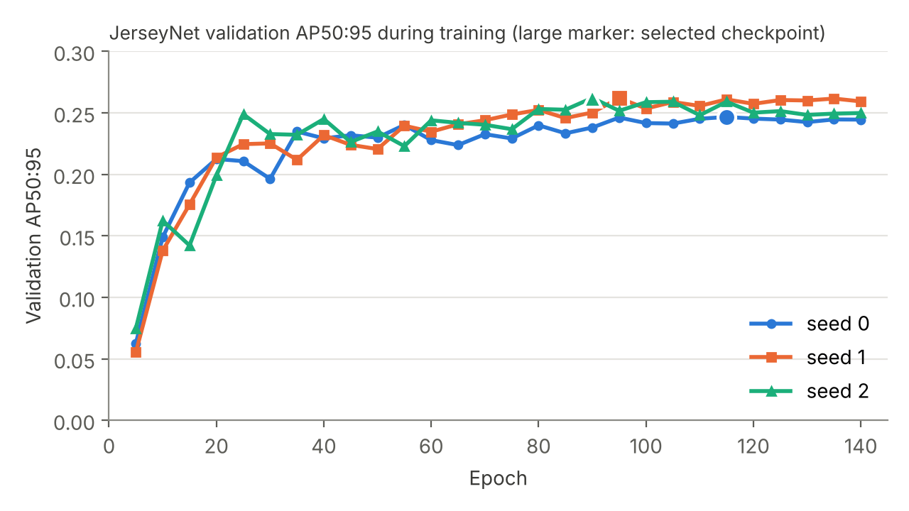

# Localising jersey numbers without pretraining: how much of the gap to YOLOv8n is pretraining?

Muzammal Hussain

> Draft. Sections marked [PENDING] depend on runs that are not finished yet.

## Abstract

We study how far a detector trained from random initialisation can go in localising jersey
numbers in sports images, and how it compares with a COCO-pretrained YOLOv8n fine-tuned on the
same data. Our first attempt, a small network that regresses one box from globally pooled
features, reached a test mean IoU of 0.044 against 0.016 for a constant mean-box prediction and
0.581 for the fine-tuned YOLOv8n. We replace it with JerseyNet, a CenterNet-style detector with a residual backbone and a
feature pyramid fused to stride 4, trained from scratch, and compare it with YOLOv8n trained from
scratch and from COCO weights at two input sizes. All models are scored with COCO-style AP over
every annotated box on the same public split, with bootstrap intervals and three seeds. JerseyNet
reaches AP50:95 of 0.241 ± 0.006 (AP50 0.495), turning the v1 network into a working detector
(first-box IoU 0.051 → 0.476). YOLOv8n reaches 0.352 from scratch and 0.384 from COCO weights at
the same 256 px input, and 0.419 at 640 px. On this task COCO pretraining adds about 0.03 AP and
higher resolution another 0.035, while the detector design and training recipe account for 0.11:
the gap to a modern detector is mainly an architecture and recipe gap, not a pretraining gap.

## 1. Introduction

Jersey-number recognition is usually framed as reading digits from a player crop. Many practical
systems first need to know where the number is. This paper treats that stage on its own: given an
image, predict a box and a confidence for every visible jersey number.

We ask two questions. How much of the localisation performance of a pretrained detector can a
network trained only on a few thousand task images recover? And how much of the gap comes from
the model design rather than from pretraining?

Contributions:

1. A reproducible protocol for jersey-number localisation on a public YOLO-format export:
   COCO-style AP over all boxes, negatives included, test intervals by bootstrap, model
   selection on validation only, and a cross-split duplicate check.
2. JerseyNet, a small anchor-free detector trained from scratch, compared with a mean-box
   baseline, our earlier single-box regressor, and a fine-tuned YOLOv8n.
3. A decomposition of the gap to a pretrained detector into resolution, pretraining, and design
   and training recipe, and an analysis of why the single-box regressor fails.

## 2. Related work

**Detection.** YOLO frames detection as a single regression problem over a grid (Redmon et al.,
2016); YOLOv8 is a later anchor-free family maintained by Ultralytics (Jocher et al., 2023).
CenterNet represents each object by its centre point on a heatmap and regresses its size at that
point (Zhou et al., 2019), with the penalty-reduced focal loss of CornerNet (Law and Deng, 2018).
It needs neither anchors nor non-maximum suppression. He et al. (2019) showed that detectors can
be trained from random initialisation when normalisation is used and training is long enough,
which motivates our from-scratch setting. IoU-based box losses such as GIoU (Rezatofighi et al.,
2019) address the scale dependence of coordinate losses. We use COCO-style average precision
(Lin et al., 2014) as the main metric.

**Jersey numbers.** Most prior work treats the problem as digit reading and assumes the player
has already been localised. Vats et al. (2021) trained a ResNet-34 with whole-number and
per-digit losses on 54,251 player images from NHL games, reporting 89.6% test accuracy. The
SoccerNet 2023 challenge introduced a public tracklet-level benchmark (Cioppa et al., 2024).
Balaji et al. (2023) added keyframe selection in front of a ResNet-18 and bidirectional LSTM,
reaching 68.53% on the SoccerNet test set. Koshkina and Elder (2024) combined legibility
filtering, pose-based torso localisation and the PARSeq scene-text recogniser, and aggregated
frame predictions to tracklet labels, reporting 87.4% tracklet accuracy on SoccerNet. Grad (2025)
proposed a single-stage, uncertainty-aware recogniser on player crops. Liu et al. (2022) used a
detection transformer to find players in American football video and a separate CNN to read their
numbers. Our work isolates the localisation of the number region inside the image, which these
pipelines either assume or obtain from pose estimation.

## 3. Data

We use the Roboflow export `jersey-2` (workspace `muzammal-masmatixinnovations-co-uk`, project
`jersey-qyuun-s5ab4`, version 1, licence Public Domain), one class (`number`), YOLO format.

| Split | Images | Labelled images | Boxes | Max boxes per image |
|---|---|---|---|---|
| Train | 3,165 | 2,784 | 4,941 | 9 |
| Validation | 301 | 263 | 485 | 6 |
| Test | 147 | 130 | 234 | 9 |

All images are 128 × 128 pixels. The median box side is about 8% of the image side (about 10
pixels), and the 10th percentile is about 3% (4 pixels).

Images without a label, or with an empty label file, are kept and act as negatives.
Cross-split duplicates: no Roboflow source name is shared between splits; with a 64-bit
difference hash and a Hamming distance of at most 4, 9 validation images and 1 test image have a
near-identical training image. The official splits are used unchanged.

## 4. Methods

### 4.1 Mean-box baseline

The mean of the first annotated box over labelled training images, predicted on every image
with confidence 1. It has no image input.

### 4.2 v1 CNN regressor

Three 3×3 convolutions (16, 32, 64 channels) with max pooling, global average pooling, a 128-unit
layer and four sigmoid outputs. Input 128×128 (stretched), Adam with learning rate 1e-3, batch 8,
MSE on the first box, 15 epochs, weights after the last epoch.

### 4.3 JerseyNet

* Backbone: a stem of two 3×3 convolutions (stride 2), then four residual stages of two basic
  blocks each, at strides 4, 8, 16 and 32 with 64, 128, 192 and 256 channels, all with batch norm.
* Neck: 1×1 lateral projections to 96 channels and a top-down path with nearest-neighbour
  upsampling and 3×3 smoothing, ending at stride 4.
* Heads at stride 4: a centre heatmap, box width and height, and a sub-pixel offset.
* Loss: penalty-reduced focal loss on the heatmap (α = 2, β = 4) with Gaussian targets whose
  radius follows CenterNet, plus L1 on size (weight 0.1) and offset (weight 1) at object centres.
* Decoding: 3×3 max-pool peak selection, the top 100 peaks, no NMS.
* Input and augmentation: 256×256 letterbox (the 128×128 images upsampled 2×, so the smallest
  numbers still span two cells of the stride-4 output), random scale in [0.6, 1.3], random placement,
  brightness, contrast and saturation jitter (±30%). No horizontal flip, which would mirror the
  digits.
* Optimisation: AdamW, learning rate 1e-3, weight decay 1e-4 (not on norms and biases), three
  warm-up epochs then cosine decay to 1% over 140 epochs, batch 64, gradient clipping at 10,
  mixed precision. Validation every five epochs; the checkpoint with the best validation
  AP50:95 is kept. About 4.7 million parameters, all randomly initialised.

### 4.4 YOLOv8n in three settings

Ultralytics YOLOv8n with its default training recipe, batch 16, seeds 0, 1 and 2, checkpoint
chosen by Ultralytics on the validation split:

* COCO-pretrained, 640 px, 50 epochs (the earlier comparison);
* COCO-pretrained, 256 px, 50 epochs (same input size as JerseyNet);
* random initialisation (`yolov8n.yaml`), 256 px, 140 epochs (same input size and epochs as
  JerseyNet).

Predictions are made with confidence threshold 0.001, NMS IoU 0.7 and at most 100 boxes per image,
and scored with the same evaluator as all other models.

## 5. Evaluation protocol

* **COCO-style AP.** AP50:95 (mean over IoU thresholds 0.50 to 0.95), AP50, AP75 and AR with at
  most 100 detections per image, over every annotated box. Detections on negative images are
  false positives. Our NumPy implementation is tested against `pycocotools`.
* **First-box IoU (v1).** On each labelled image, the highest-scoring box against the first
  annotated box; mean IoU and the share with IoU ≥ 0.5. An image with no prediction scores 0.
* **Selection and reporting.** Checkpoints are chosen on validation AP50:95. The test split is
  scored once per trained model. Test metrics carry 95% percentile bootstrap intervals over
  images (1,000 resamples). JerseyNet is trained with seeds 0, 1 and 2, and we report mean and
  standard deviation.

## 6. Results

v1 protocol, test split (130 scored images), from the earlier runs:

| Model | Mean IoU | Share with IoU ≥ 0.5 |
|---|---|---|
| Mean-box baseline | 0.016 | – |
| v1 CNN regressor (15 epochs) | 0.044 | – |
| YOLOv8n (fine-tuned, 50 epochs) | 0.581 | 68.5% |

Full protocol, test split (147 images, 234 boxes), with 95% bootstrap intervals over images.
JerseyNet is the mean ± standard deviation over seeds 0, 1 and 2.

| Model | Pretrained | Input | AP50:95 | AP50 | AP75 | AR@100 | First-box mean IoU | First-box IoU ≥ 0.5 |
|---|---|---|---|---|---|---|---|---|
| Mean-box baseline | – | – | 0.000 | 0.000 | 0.000 | 0.000 | 0.016 [0.008, 0.025] | 0.0% |
| v1 CNN regressor | no | 128 | 0.000 | 0.000 [0.000, 0.002] | 0.000 | 0.001 | 0.051 [0.033, 0.069] | 0.0% |
| JerseyNet | no | 256 | 0.241 ± 0.006 | 0.495 ± 0.004 | 0.227 ± 0.008 | 0.371 ± 0.011 | 0.476 ± 0.023 | 59.5 ± 3.5% |
| YOLOv8n | no | 256 | 0.352 ± 0.013 | 0.629 ± 0.019 | 0.372 ± 0.005 | 0.470 ± 0.013 | 0.544 ± 0.017 | 66.7 ± 1.9% |
| YOLOv8n | COCO | 256 | 0.384 ± 0.003 | 0.675 ± 0.004 | 0.394 ± 0.017 | 0.489 ± 0.004 | 0.576 ± 0.016 | 71.0 ± 1.9% |
| YOLOv8n | COCO | 640 | 0.419 ± 0.012 | 0.701 ± 0.008 | 0.476 ± 0.034 | 0.538 ± 0.012 | 0.590 ± 0.007 | 70.0 ± 1.5% |

The baselines are single runs (bootstrap intervals in brackets); the detectors are mean ± standard
deviation over three seeds. Per-seed numbers with intervals are in the repository
(`docs/experiments/`). The YOLOv8n 640 px seed-0 run reproduces the earlier first-box result
exactly (0.581, 68.5%).

**Where the gap comes from.** Reading the table from the bottom up on AP50:95, lowering the input
from 640 to 256 px costs 0.035, removing COCO pretraining costs 0.032, and replacing YOLOv8n's
design and recipe with JerseyNet's, both from scratch at 256 px, costs 0.111. Pretraining is
therefore a small part of the gap on this task; a from-scratch YOLOv8n recovers most of the
pretrained model's accuracy. The decisive factors are in the detector and its training: YOLOv8n's
multi-scale heads, its box-regression losses and its heavier augmentation (mosaic among others)
are absent from JerseyNet, which uses a single stride-4 head, an L1 size loss and light
augmentation. These are the natural next ablations.

Per-seed test AP50:95 is 0.234, 0.246 and 0.242 (validation 0.247, 0.262, 0.262). The
re-trained v1 regressor (0.051) reproduces the earlier 0.044 within its interval, and the
mean-box baseline matches the earlier 0.016 exactly, which cross-checks the new evaluator.

On the first-box metric JerseyNet moves from the v1 regressor's 0.051 to 0.476, against 0.590
for the pretrained YOLOv8n at 640 px; the decomposition above shows how the remaining gap splits
between resolution, pretraining and design.
Training is short: each seed ran 140 epochs in about 22 minutes on one T4 GPU. Validation
AP50:95 reaches about 0.23 by epoch 25 and changes little after epoch 90 (Figure 1); the selected
checkpoints come from epochs 115, 95 and 90. Validation scores are 0.01 to 0.02 AP above test,
consistent with checkpoint selection on validation.



*Figure 1. Validation AP50:95 every five epochs for the three seeds. The large marker is the
checkpoint selected for testing.*

Training cost per seed on one T4: JerseyNet 22 minutes (140 epochs), YOLOv8n from scratch
34 minutes (140 epochs), YOLOv8n from COCO 12 minutes (50 epochs, 256 px) and 22 minutes
(640 px).

## 7. Analysis of the v1 regressor

Ablation of the v1 regressor, test split, run before the box-ordering fix:

| Variant | Box loss | Epochs | Checkpoint | Box MSE | Mean IoU |
|---|---|---|---|---|---|
| A. Default | MSE | 15 | validation loss | 0.031 | 0.044 |
| B. Longer training | MSE | 50 | validation loss | 0.034 | 0.039 |
| C. GIoU box loss | GIoU | 15 | validation loss | 0.170 | 0.000 |
| D. GIoU, IoU selection | GIoU | 50 | validation IoU | 0.280 | 0.000 |

Longer training does not help, and neither loss moves the regressor beyond the baseline range.
The design is the likely limit: global average pooling discards where features occur, the
model can output only one box although images hold up to nine numbers, and the 128 × 128 input
leaves the smallest numbers about four pixels wide. JerseyNet addresses each of these (a spatial
heatmap, any number of outputs, stride-4 features on a 2× upsampled input). The GIoU collapse is reported as a negative
result with an open diagnosis; the v1 code is preserved in the version 1.0.0 archive.
The v2 results support this: the same data and budget, with a spatial detector, give a
ten-fold higher first-box IoU.

## 8. Limitations

* One dataset with 147 test images; intervals are wide.
* Frames from one match may sit in different splits; we measure but do not remove this.
* Localisation only; the digits are not read.
* YOLOv8n uses its own default recipe (augmentation, losses, schedule); JerseyNet's recipe is
  simpler. The from-scratch comparison is between complete systems, not architectures alone.
* GPU training is seeded but not bit-for-bit deterministic.

## 9. Reproducibility

Code: `https://github.com/MHKhan50/jersey-number-detection` (version 2.0.0).

```bash
jersey-detect run --data /data/jersey-2 --out results --config configs/kaggle.json
```

The notebook `notebooks/kaggle_train.ipynb` runs the same command on a Kaggle T4 GPU and records
the environment and the exact commit in `results/environment.json`.

## 10. AI-use disclosure

[PENDING: check the target venue's policy before submission.]

## References

- Balaji, B., Bright, J., Prakash, H., Chen, Y., Clausi, D. A., & Zelek, J. (2023). Jersey number recognition using keyframe identification from low-resolution broadcast videos. *MMSports '23*. arXiv:2309.06285.
- Cioppa, A., Giancola, S., Somers, V., et al. (2024). SoccerNet 2023 challenges results. *Sports Engineering*, 27, 24.
- Grad, Ł. (2025). Single-stage uncertainty-aware jersey number recognition in soccer. *CVPR Workshops (CVsports)*.
- He, K., Girshick, R., & Dollár, P. (2019). Rethinking ImageNet pre-training. *ICCV*.
- Jocher, G., Chaurasia, A., & Qiu, J. (2023). *Ultralytics YOLO* (version 8). https://github.com/ultralytics/ultralytics
- Koshkina, M., & Elder, J. H. (2024). A general framework for jersey number recognition in sports video. *CVPR Workshops*, 3235–3244.
- Law, H., & Deng, J. (2018). CornerNet: Detecting objects as paired keypoints. *ECCV*.
- Lin, T.-Y., Maire, M., Belongie, S., et al. (2014). Microsoft COCO: Common objects in context. *ECCV*.
- Liu, H., Aderon, C., Wagon, N., Bamba, A. L., Li, X., Liu, H., MacCall, S., & Gan, Y. (2022). Automated player identification and indexing using two-stage deep learning network. arXiv:2204.13809.
- Redmon, J., Divvala, S., Girshick, R., & Farhadi, A. (2016). You only look once: Unified, real-time object detection. *CVPR*.
- Rezatofighi, H., Tsoi, N., Gwak, J., Sadeghian, A., Reid, I., & Savarese, S. (2019). Generalized intersection over union. *CVPR*.
- Vats, K., Fani, M., Clausi, D. A., & Zelek, J. (2021). Multi-task learning for jersey number recognition in ice hockey. *MMSports '21*.
- Zhou, X., Wang, D., & Krähenbühl, P. (2019). Objects as points. arXiv:1904.07850.
